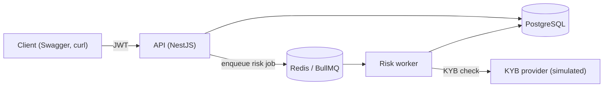
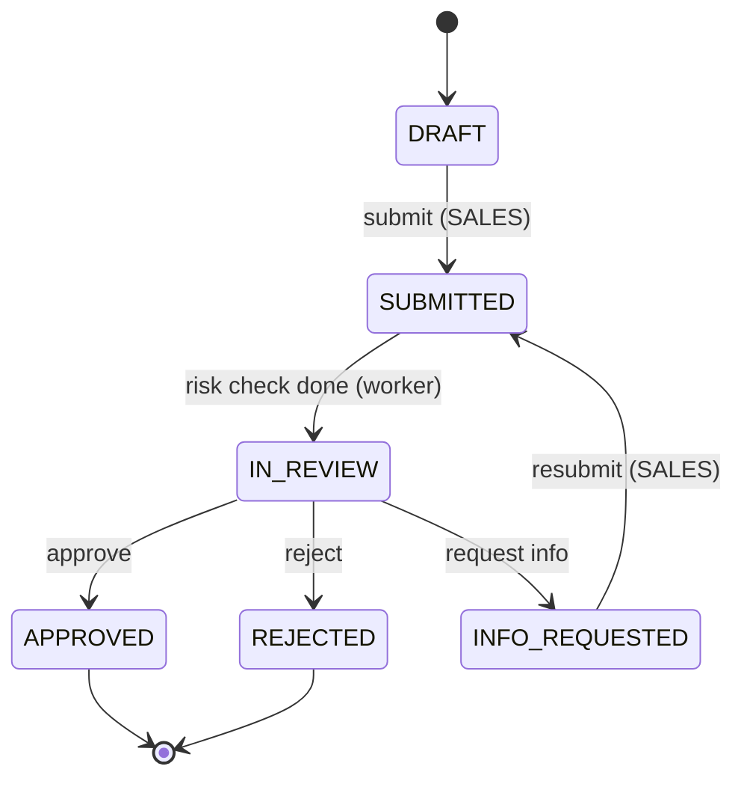
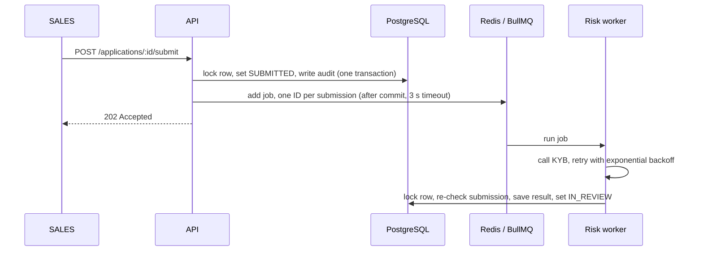

# Merchant Onboarding API

A back-office API for onboarding merchants. Sales staff create applications, a background worker runs a (simulated) KYB risk check, an admin assigns a reviewer, and the reviewer approves, rejects or asks for more information.

**Stack:** NestJS, PostgreSQL + TypeORM, Redis + BullMQ, JWT, Swagger, Jest + Supertest, Docker Compose.

## Run it

You need Docker and Node 24 (`nvm use`).

```bash
cp .env.example .env
```

Fill in the four empty values in `.env` with freshly generated ones:

| Variable               | Generate with             |
| ---------------------- | ------------------------- |
| `POSTGRES_PASSWORD`    | `openssl rand -hex 16`    |
| `JWT_ACCESS_SECRET`    | `openssl rand -base64 48` |
| `FIELD_ENCRYPTION_KEY` | `openssl rand -base64 32` |
| `SEED_USER_PASSWORD`   | `openssl rand -base64 18` |

```bash
docker compose up -d
npm ci
npm run migration:run
npm run seed
npm run start:dev
```

- API: http://localhost:3000/api/v1
- Swagger: http://localhost:3000/api/docs (log in with `POST /auth/login`, click **Authorize**, paste the `accessToken`)
- Postgres is on port 5433, so it doesn't clash with a local install.

**Demo accounts** (all fake). The password is `SEED_USER_PASSWORD` from `.env`.

| Email                       | Role                   |
| --------------------------- | ---------------------- |
| `maya.admin@example.com`    | ADMIN                  |
| `ram.reviewer@example.com`  | REVIEWER               |
| `gita.reviewer@example.com` | REVIEWER               |
| `sita.sales@example.com`    | SALES                  |
| `hari.sales@example.com`    | SALES                  |
| `old.reviewer@example.com`  | REVIEWER (deactivated) |

**API and worker as separate processes:**

```bash
RUN_RISK_WORKER=false npm run start:dev
npm run start:worker:dev
```

**Everything in Docker** (API, worker and a one-off migration job). If port 3000 is taken, prefix the first command with `API_HOST_PORT=3200`.

```bash
docker compose --profile app up -d --build
docker compose --profile app run --rm api node dist/database/seed.js
```

**Tests.** These need Postgres and Redis running. The integration tests use their own `_test` database and Redis DB 1.

```bash
npm test
npm run test:e2e
npm run typecheck
npm run lint
```

All settings, with comments, are in `.env.example`.

## Architecture



### Application lifecycle



Only the assigned reviewer makes decisions. If the risk check fails, the application stays in SUBMITTED until an ADMIN retries it. Any other move returns 409.

### Submit and the risk check



### Key points

- **Modules:** `auth`, `users`, `applications`, `risk`, `audit`, `health`, with shared code in `common`. Requests go controller → service → repository.
- **Access:** every application query goes through one visibility scope. ADMIN sees all applications, SALES only their own, and a REVIEWER only the ones assigned to them. An application outside your scope returns 404, not 403. Roles are checked by a guard and again in the service.
- **Consistency:** every state change locks the application row and writes its audit entry in the same transaction. A database trigger makes the audit table append-only.
- **Idempotency:** each submission gets one job ID. The worker re-checks the state before and after calling the provider. A unique constraint on (application, submission) blocks duplicates.
- **Sensitive data:** national IDs are encrypted with AES-256-GCM and shown masked. Passwords are hashed with bcrypt. Refresh tokens are stored as hashes and rotated, with reuse detection. Logs never contain secrets, tokens or request bodies.
- **Errors:** every error uses the same JSON shape, with a `code` and the request ID.

The full design (data model, access rules and decisions) is in [docs/design/index.html](docs/design/index.html).

## Limitations

- No outbox table. If the API crashes between the commit and adding the job, the risk check stays PENDING.
- The login rate limit is counted in memory, so each API instance counts separately.
- The audit trigger blocks UPDATE and DELETE but not TRUNCATE. A database role without those rights would close the gap.
- Expired refresh tokens aren't cleaned up, and the audit log isn't partitioned.
- No security headers or CORS yet (there is no browser client), and no metrics or tracing.
- The KYB provider is simulated. The optional webhook and MongoDB audit storage aren't built.
